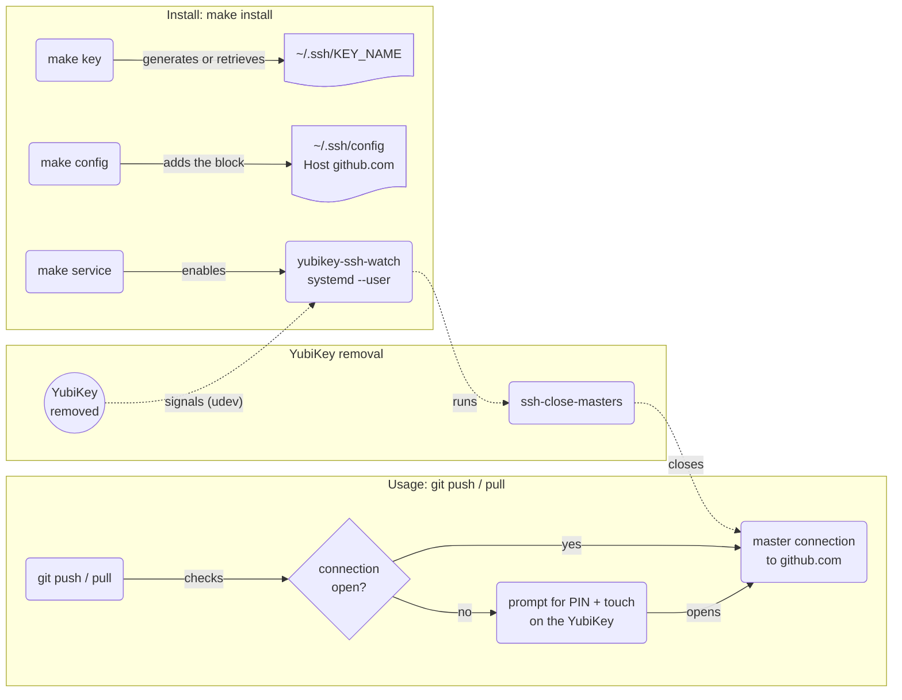

# SSH key on Yubikey

**Goal:** use an SSH key stored on a YubiKey for GitHub, without a PIN and touch prompt on every Git command.

The key is generated inside the YubiKey and never leaves it. The PIN and touch open a persistent connection to GitHub once; that connection is closed as soon as the YubiKey is unplugged.



## Prerequisites

Check prerequisites with `make check`

## Quick start

```bash
# generate a new key + update ~/.ssh/config + register a user service
make install   
```

`make help` lists the other targets.

## Change the key name

`KEY_NAME` sets the file in `~/.ssh` and the FIDO *application* under which the key is stored on the YubiKey:

| `KEY_NAME`         | File                   | FIDO application |
|--------------------|------------------------|------------------|
| *(empty, default)* | `~/.ssh/id_ed25519_sk` | `ssh:`           |
| `work`             | `~/.ssh/work`          | `ssh:work`       |

To set it on a machine, create `local.mk` (not versioned):

```make
KEY_NAME = work
```

## Deploy the public key

Examples use the default name (replace `id_ed25519_sk` with `KEY_NAME` if set):

```bash
gh ssh-key add ~/.ssh/id_ed25519_sk.pub --title yubikey   # GitHub
ssh-copy-id -i ~/.ssh/id_ed25519_sk.pub user@host         # Server (OpenSSH ≥ 8.4)
```
